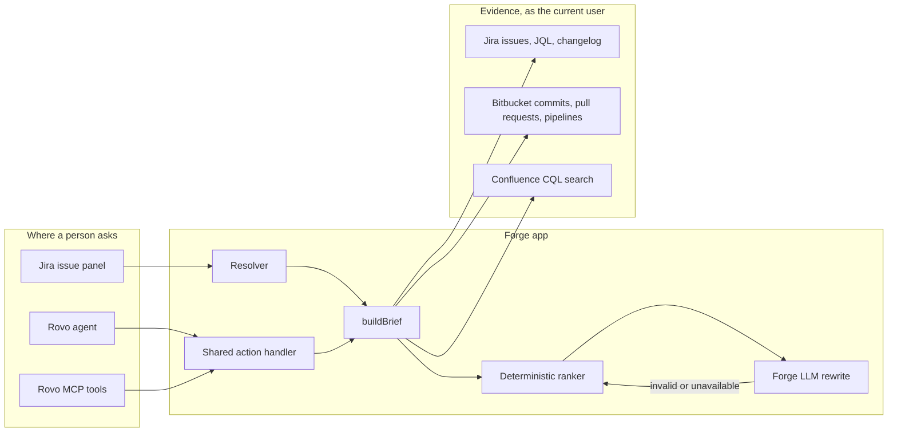

# Incident Context Copilot

Incident Context Copilot is an Atlassian Forge app for the Codegeist 2026 hackathon. Source: [github.com/wangli-hackathon/incident-context-copilot](https://github.com/wangli-hackathon/incident-context-copilot).

Open a Jira bug or incident and it gathers the evidence already around that work item, then ranks likely causes, suggests who should own it, and writes the next checklist.

The same analysis is available in three places:

- a Jira issue panel
- a Rovo agent, with a skill that tells the agent which action to call
- a Rovo MCP server, so a custom agent in Rovo Studio (and, once an admin enables it, an external MCP client) can call the same tools

The ranker is deterministic. Forge LLM is an optional rewrite that is not allowed to invent evidence. The panel works with the ranking alone, so a demo does not need LLM quota.

## Features

- Reads the Jira work item, its comments, links, and remote links.
- Searches similar bugs, incidents, and problems with JQL, and notes who last moved a resolved match to Done.
- Searches Confluence for runbook pages with CQL.
- Has a Bitbucket collector for commits, pull requests, and recent pipelines. **The deployed build does not request Bitbucket scopes** (see [Current deployment](#current-deployment)), so on a live site the code and deploy tabs show a note instead of live Bitbucket data. **Load sample incident** shows the full code-and-deploy story.
- Ranks failed production pipelines, hotfixes that touch a file named in the stack, open pull requests, and similar resolved issues. Weak or unrelated changes stay in the evidence tabs and out of the ranking.
- Suggests an assignee from the people who authored that code or resolved the similar issues. It does not assign the work item.
- Builds a checklist: confirm impact, inspect a failed deploy, assign an owner, then review the commit, pull request, runbook, and past resolution.
- **Load sample incident** shows a frozen PAY-204 story (failed production pipeline, hotfix commit, open pull request, runbook, similar incident) with no site data.
- **Enhance with Forge LLM** asks Claude Sonnet 4.6, hosted by Forge, to rewrite the brief. If the call fails or the model names something that was not fetched, the evidence ranking stays on screen.

The app is read-only. It does not transition, assign, or comment.

## Architecture



Jira's development panel is not a supported Forge API. The app does not call `/rest/dev-status`. Its Bitbucket collector reads Bitbucket directly (not live in the current deployment; see below), plus any deployment-shaped remote link already on the work item. Pipeline runs on `main` are treated as production deployments.

Confidence is a sum of explicit weights (a failed production pipeline that names the issue key scores higher than an old unrelated commit). The weights are in `skills/incident-context/references/evidence-rules.md` and covered by unit tests. Causes under 25 are omitted from the ranking.

## How this meets Codegeist 2026

Theme: **Build with context, ship with confidence.** The app refuses to ship a cause, owner, or runbook that it did not fetch. Forge LLM may reorder and rephrase. It cannot add a cause id.

Category: **Software Teams.** The user is the person on a bug or incident who needs the change, the deploy, the runbook, and a name.

Rovo Agent bonus: `rovo:agent` **Incident Context Copilot**, six `GET` actions, and a `rovo:skill` playbook.

Atlassian MCP bonus: one `rovo:mcp` module, **Incident Context**, exposing those same actions as tools. Preview endpoint, after an admin enables external tools:

`https://mcp.atlassian.com/forge/<app-id-uuid>`

The app calls only Atlassian APIs and Forge LLM, so it is shaped for Runs on Atlassian. The badge itself is granted by Atlassian at deploy time and has not been confirmed here.

Deadline context: Codegeist 2026 submissions close **23 December 2026**. Submission drafts are in `DEVPOST.md` and `DEMO_SCRIPT.md`.

## Run the tests

```bash
npm install
npm test
```

Node 20 or newer. The tests do not need Atlassian credentials. They cover ranking, assignee choice, the checklist, Jira and Bitbucket payload mapping, JQL and CQL, the LLM merge rules, collector failures, and the manifest wiring.

## Install for judges

The simplest path is the installation link on the Devpost submission page: a site admin opens it, picks a site, and installs on Jira (and Confluence, for runbook search). Use **Load sample incident** if the site has no incident history.

To deploy your own copy instead, you need the Forge CLI, an Atlassian account, and a site with Jira. Confluence on the same site makes the runbook section live. Without it, that section shows a warning and the rest of the brief still renders.

### 1. Register your own copy

The committed `app.id` belongs to the author's registered app. To deploy your own copy, run `forge register`, which replaces it.

```bash
npm install -g @forge/cli@15
forge login
forge register
```

### 2. Deploy

```bash
forge deploy
```

The first deploy uses the development environment. Adding the `llm` module on a later version is a major upgrade and needs an admin to approve it. This first install already includes it.

### 3. Install

```bash
forge install --product jira
```

Or, when you already know the site:

```bash
forge install --site your-site.atlassian.net --product jira --environment development
```

Accept the scopes. They are all read, plus `storage:app` for the saved repository setting:

- `read:jira-work`, `read:jira-user`
- `search:confluence`, `read:page:confluence`
- `storage:app`

Bitbucket scopes are not in the manifest. See [Current deployment](#current-deployment).

Later deploys:

```bash
forge deploy
forge install --upgrade
```

### 4. Open a bug

The panel button is shown on work items whose type is **Bug**, **Incident**, **Problem**, or **[System] Incident**. Only people who can edit the work item see the button. That is a Jira issue panel rule.

If your site uses another type name, add it under `displayConditions` in `manifest.yml`, or remove `displayConditions` for the demo, then redeploy.

In the panel:

1. Click **Incident Context**.
2. Click **Load sample incident** to see the full PAY-204 story through the real ranker, or review the live brief built from Jira and Confluence. The repository form is still in the panel, but with the current scopes Bitbucket reads return a note rather than data.
3. Review causes, the suggested owner, and the checklist.
4. Leave **Enhance with Forge LLM** off for a quota-free demo. Turn it on only if the developer account can pay for Forge LLM. Billing for Forge LLMs started on 1 June 2026. There is no free quota. The model id is `claude-sonnet-4-6` in `src/lib/constants.js`.

### 5. Rovo agent

In Jira, open **Ask Rovo** and choose **Incident Context Copilot**. Ask "What are the likely causes of this incident?" while a bug is on screen. The agent calls the read-only actions. Rovo writes the reply. The actions themselves return the deterministic brief unless `useLlm` is true.

### 6. MCP

In Rovo Studio, create an agent, choose **Add tools**, and under connected apps add the Incident Context tools.

To expose them to an external MCP client, a site admin enables the tools under **Atlassian Administration > Apps > your site > Connected apps**, then connects the client to:

`https://mcp.atlassian.com/forge/<app-id>`

The app id is the UUID in `manifest.yml` after `forge register`. External MCP calls run as the user. The action handler does not fall back to `asApp()` for that reason.

## Project layout

```
manifest.yml                 Panel, agent, skill, MCP, actions, LLM
src/index.js                 Resolver and action handler
src/frontend/index.jsx       Issue panel UI Kit
src/analysis/                Collectors, brief, action dispatch
src/clients/                 Jira, Confluence, Bitbucket, KVS, Forge LLM
src/lib/                     Ranking and the other pure functions
skills/incident-context/     Rovo skill and the evidence rules
test/                        Unit tests
DEVPOST.md                   Submission draft
DEMO_SCRIPT.md               Video script, under three minutes
```

## Current deployment

As of 11 November 2026:

- App id `c578bc98-a306-4530-810d-4c027725c025` is registered.
- Major version 2 is deployed to the **development** environment and installed on `wangli-codegeist.atlassian.net` (Jira and Confluence). Version 2.0.0 is also deployed to the **production** environment, which is the one the installation link uses.
- `forge lint` reports no issues. Forge reports the production version as eligible for Runs on Atlassian; the badge itself is granted by Atlassian.
- **Bitbucket is not live.** Forge rejects a manifest that mixes Bitbucket workspace scopes with Jira and Confluence site scopes (`MANIFEST_INVALID_RULE`), so the Bitbucket scopes were removed to ship the panel, the Rovo agent, and the MCP tools. The Bitbucket collector and its tests remain in the code; on a live site it degrades to a note. Code and deploy evidence in the demo comes from **Load sample incident**, which runs the frozen PAY-204 story through the same ranker.
- Forge LLM is off by default. Forge LLM has no free quota, so the demo does not use it.
- Rovo agent and MCP tool availability depend on the installing site's Rovo and admin settings.

## License

MIT. See [LICENSE](LICENSE).
